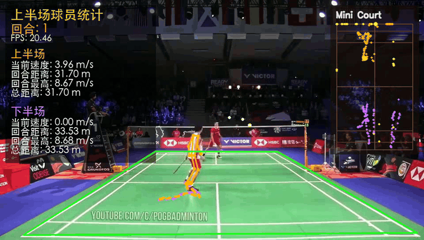
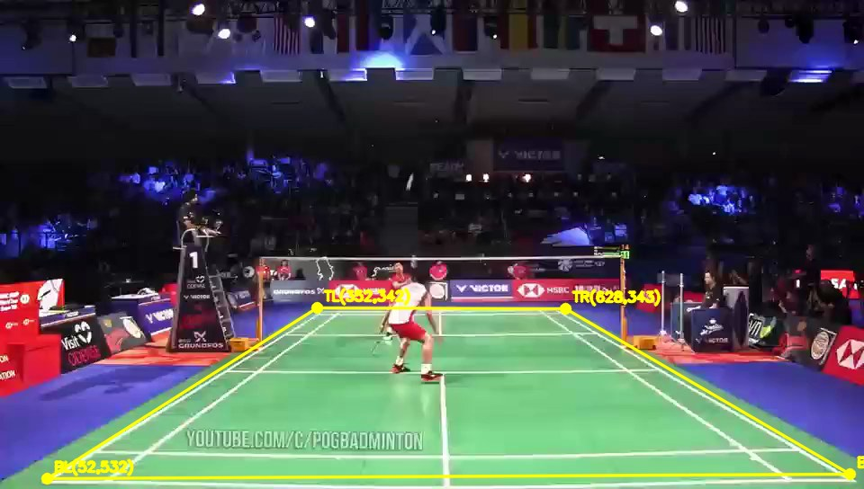
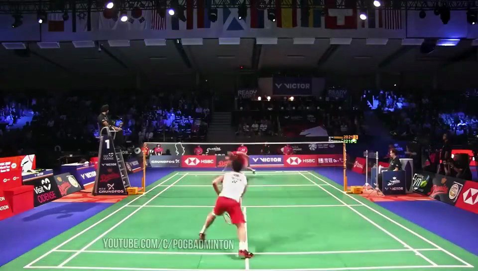
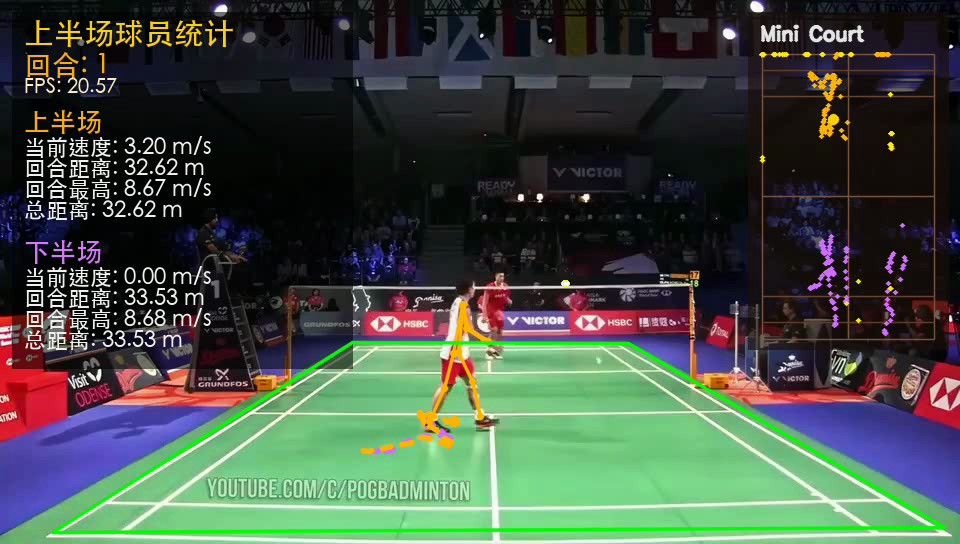
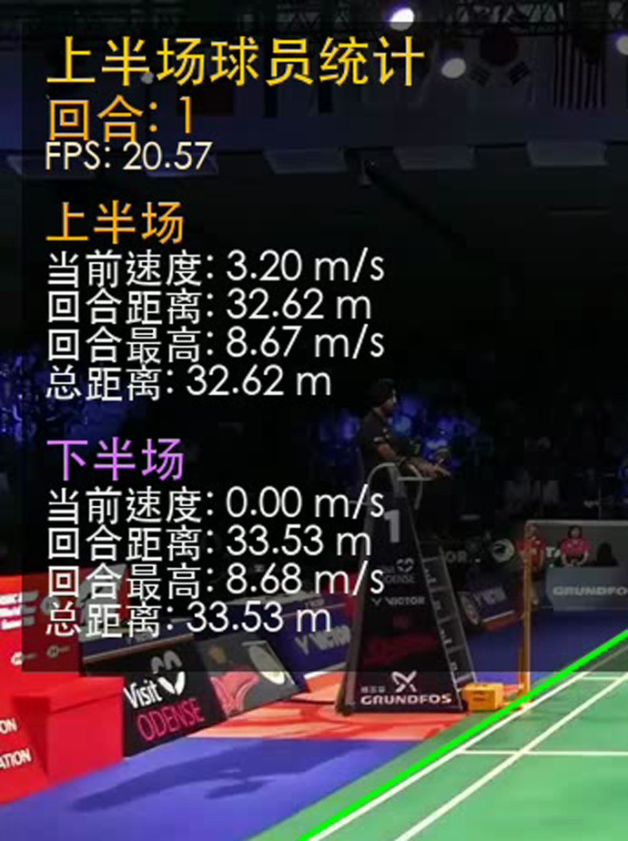
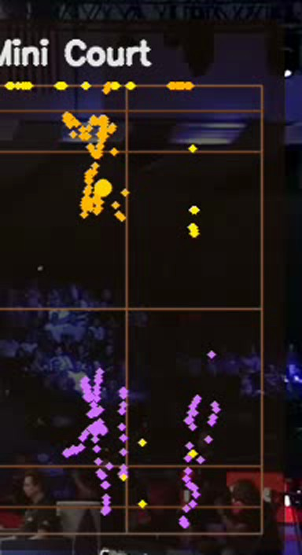

# Badminton Match Video Analytics Pipeline

[简体中文](README.md) · **English**

[](https://www.python.org/)
[](https://pytorch.org/)
[](https://www.apple.com/macos/)
[](#license)
[](https://github.com/ychenfen/badminton-pipeline-repro/pulls)

End-to-end pipeline that turns a regular badminton match video into an analytics overlay: **player trajectories, movement speed, accumulated distance, shuttle flight path**, plus optional bullet-time effects.

Built on **TrackNet (shuttle detection with native Apple Silicon MPS GPU acceleration) + 2D Kalman trajectory smoothing + RallyDetector (auto rally segmentation & hit detection) + YOLOv8s-pose (player keypoints) + ByteTrack (ID tracking) + court homography + BWF court heatmaps**. Tested end-to-end on Apple Silicon (M4 Pro).



---

## What's New in v1.1.0

- **Native Apple Silicon MPS GPU Acceleration for TrackNet** (`scripts/tracknet_runtime/predict.py`): `--device auto` now automatically selects `cuda`, `mps`, or `cpu`, and `--vis_thresh` defaults to `0.15` so users never hit 0% recall if they forget the environment variable. Full-match inference drops from ~3 hours (CPU) to ~25–30 minutes on M-series Macs.
- **`RallyDetector` + Hit Detection + FFmpeg Batch Clipper** (`scripts/tools/rally_detector.py`): Importable `RallyDetector` class and CLI tool that segments `[start_frame, end_frame]` rally boundaries, detects racket hit frames, exports `rallies.json` & `rallies.csv`, and slices `rally_XX.mp4` + `highlights.mp4` via FFmpeg.
- **Shuttle Trajectory Gap Interpolation & 2D Kalman Smoothing** (`scripts/tools/smooth_ball_csv.py`): Pure-NumPy 4-state `[x, y, vx, vy]` constant-velocity Kalman filter + RTS smoother that interpolates short occlusion gaps (`<= 8` frames) while preserving true out-of-play intervals.
- **Analytics JSON Export & BWF Court Heatmap** (`overlay_player_analytics.py --export_json` & `scripts/tools/heatmap.py`): Exports per-frame player/shuttle real-world court coordinates (`analytics.json`), caches YOLO detections (`--cache_dir`), and renders a 2-panel publication-grade `court_heatmap.png` (Panel 1: Player Court Coverage / Shuttle Density Heatmap; Panel 2: Shuttle Hit/Landing Scatter Plot on a 6.1m x 13.4m BWF court).
- **Root MIT `LICENSE` & Unit Test Suite** (`tests/test_v1_1_tools.py`).

---

## Why this exists

Most "open-source badminton analyzer" projects either:
- only do shuttle detection (no player analytics)
- assume a top-down camera (real broadcasts are oblique)
- hard-code Windows paths and break on macOS / Linux
- have hardcoded thresholds that silently fail on real videos (e.g. 0% ball detection)

This repo is the **fully working, debugged, fully Mac-friendly** version of the chain, with every fix documented in [HANDOVER.md](HANDOVER.md).

## What you get

- **Real-time speed** per player (m/s, smoothed over 6 frames)
- **Per-rally distance + max speed** + **total distance** since video start
- **Mini-court trail visualization** for both players and the shuttle
- **Court perspective correction** — distances are in real meters, not pixels
- **Bullet-time freeze + slow motion** as cinematic finishing FX

## Architecture

```
Raw video.mp4
    │
    ▼  Step 1: TrackNet ──────────── shuttle detection (multi-frame heatmap model)
TrackNet visualization video + ball CSV
    │
    ▼  Step 2: Overlay ───────────── YOLOv8s-pose + ByteTrack + Homography
Overlay video with full analytics
    │
    ▼  Step 3: FX ───────────────── bullet-time freeze + slow-mo + virtual orbit
Final cinematic video
```

Each stage runs independently. Tweaking the panel, retuning thresholds, or adding new effects only needs the relevant stage to re-run.

---

## Quickstart (30-second sample)

### 1. Clone (Git LFS)

```bash
git lfs install     # brew install git-lfs first if missing
git clone https://github.com/ychenfen/badminton-pipeline-repro.git
cd badminton-pipeline-repro
```

Model weights (`weights/TrackNet_best.pt` 130 MB) and sample videos are pulled via Git LFS.

### 2. Install dependencies

```bash
python3 -m pip install --user --index-url https://pypi.org/simple \
    numpy opencv-python pandas Pillow torch ultralytics tqdm \
    pycocotools parse lap
```

`pycocotools`, `parse`, `lap` are hidden TrackNet/ByteTrack deps not in the original `requirements.txt`.

### 3. Mark 4 court corners (the only manual step)

```bash
python3 scripts/tools/select_court.py short.mp4
```

Click in order: **TL → TR → BR → BL** (the four corners of the court rectangle, **not** the net poles). Press `q` when done. The script prints a `--court_points "x1,y1,..."` string.

For the included `short.mp4`:

```
352,342,628,343,944,527,52,532
```



### 4. Run all three stages (with smoothing, rally detection & court heatmap)

```bash
./run_all_mac.sh \
  --input-video short.mp4 \
  --tracknet-device auto \
  --eval-mode nonoverlap \
  --yolo-device mps \
  --smooth-ball \
  --detect-rallies \
  --export-heatmap
```

`run_all_mac.sh` now defaults to `TRACKNET_VIS_THRESH=0.15` and the calibrated `short.mp4` court corners (`352,342,628,343,944,527,52,532`), and automatically uses Apple Silicon `mps` for TrackNet when `--tracknet-device auto` is set.

### 5. Outputs

In `~/yumaoqiu_repro/`:
- `tracknet_v3_result_regen/short_ball.csv` & `short_ball_smoothed.csv` — raw and Kalman-smoothed per-frame ball coordinates
- `rallies.json` & `rallies.csv` — segmented rally boundaries (`[start_frame, end_frame]`) and detected hit frames
- `analytics.json` & `court_heatmap.png` — per-frame court-meter analytics and 2-panel BWF court coverage heatmap
- `end1_fix_swap2_precision_full_regen.mp4` — analytics overlay video
- `end1_fix_swap2_precision_full_fx_regen.mp4` — final FX video

A pre-rendered demo lives at `demo/short_overlay_demo.mp4`.

---

## What each stage does

### Step 1 — TrackNet (shuttle detection)

**The problem**: shuttlecocks are tiny (5-10 px), fast, and motion-blurred. Single-frame detectors (YOLO, etc.) miss them constantly.

**The trick**: TrackNet ingests 4 consecutive frames and outputs 4 probability heatmaps. Cross-frame motion makes the blurred shuttle visible to the network. Think: you can't tell where a mosquito is in one photo, but in 4 burst shots you can clearly see something flew past.



The CSV format:

```csv
Frame,Visibility,X,Y
0,1,455,202
1,1,455,202
4,1,481,122
```

### Step 2 — Overlay (player tracking + analytics)

90% of the codebase. Five jobs:

1. **YOLOv8s-pose** detects each player + 17 keypoints (ankle keypoints give precise foot positions)
2. **ByteTrack** maintains per-player IDs across frames so trajectories don't fragment
3. **Homography** warps the oblique court trapezoid into a top-down rectangle:

   ```
   Camera-view trapezoid              Top-down court
                                       (0, 0) ─── (6.1, 0)
      TL ────── TR                       │           │
       \        /        Homography      │           │
        \      /         ──────────►     │           │
         \    /                          │           │
      BL ────── BR                       │           │
                                       (0, 13.4)── (6.1, 13.4)
   ```

   `cv2.findHomography(court_quad, dst_rectangle)` gives a 3×3 matrix. Any pixel coordinate then projects to real-world meters, so distance and speed are camera-independent.

4. **MotionStats** per player: instant speed, rally distance, rally max speed, total distance
5. **Drawing**: stats panel (left), mini court (top-right), player skeletons + trails





### Step 3 — FX (bullet-time)

Inspired by *The Matrix*. Lightweight monocular version:

- Pick "bullet moments" (manual / uniform / auto-detected motion peaks)
- Freeze 28 frames at each, virtual orbit camera does small rotation + zoom
- Follow with 40 frames slow motion (each frame repeated 6× with optional interpolation)
- Resume normal playback

Pure post-processing on the Step 2 output, no detection involved.

---

## Performance (MacBook Apple M4 Pro)

| Stage | CPU | MPS (GPU, supported in v1.1.0) |
|---|---|---|
| TrackNet (13344 frames) | ~3 hours | **~25–30 min** (`--device mps` / `auto`) |
| Overlay | ~30 min | ~10 min (~30 sec on re-runs with `--cache_dir`) |
| FX | ~5 min | same |

---

## Standalone Analytics Tools (v1.1.0)

### 1. `RallyDetector` — Auto Rally Segmentation, Hit Detection & FFmpeg Clipper

```bash
python3 scripts/tools/rally_detector.py \
  --ball_csv ~/yumaoqiu_repro/tracknet_v3_result_regen/short_ball.csv \
  --fps 21.0 \
  --min_rally_frames 30 \
  --max_missing_frames 25 \
  --cut_video short.mp4 \
  --out_dir ~/yumaoqiu_repro/rallies
```

Or import directly in Python:

```python
from scripts.tools.rally_detector import RallyDetector

detector = RallyDetector(fps=21.0, min_rally_frames=30, max_missing_frames=25)
rallies = detector.detect_from_csv("short_ball.csv")
boundaries = detector.get_boundaries()  # [(start_frame, end_frame), ...]
```

### 2. `smooth_ball_csv.py` — Trajectory Interpolation & 2D Kalman Smoothing

```bash
python3 scripts/tools/smooth_ball_csv.py \
  ~/yumaoqiu_repro/tracknet_v3_result_regen/short_ball.csv \
  --output ~/yumaoqiu_repro/tracknet_v3_result_regen/short_ball_smoothed.csv \
  --max_gap 8
```

### 3. `heatmap.py` — 2-Panel BWF Court Coverage Heatmap & Hit Scatter Plot

```bash
python3 scripts/tools/heatmap.py \
  ~/yumaoqiu_repro/analytics.json \
  --output ~/yumaoqiu_repro/court_heatmap.png
```

---

## FAQ

**Q: Ball completely undetected (Visibility all 0).**
A: Did you set `TRACKNET_VIS_THRESH=0.15`? Default 0.5 fails on most videos. See [HANDOVER §6.1.4](HANDOVER.md).

**Q: Player speed reads 24 m/s (faster than Bolt).**
A: ID-switch jumps were being recorded as max speed. Already fixed with adaptive threshold `8.0 × dt + 0.05`. See [HANDOVER §6.2.7](HANDOVER.md).

**Q: Chinese characters render as boxes.**
A: macOS PingFang fallback already added. Verify `/System/Library/Fonts/PingFang.ttc` exists.

**Q: Court polygon doesn't align with the actual court.**
A: Re-run `select_court.py` and click in TL → TR → BR → BL order. Add `--draw_court_polygon` to overlay command to verify.

**Q: `ModuleNotFoundError: pycocotools / parse / lap`.**
A: Hidden deps not in `requirements.txt`. Install with the command in step 2 above.

More: [HANDOVER §8](HANDOVER.md).

---

## Roadmap

[HANDOVER.md §10](HANDOVER.md) lists 12 detailed tasks (P0-P3), each formatted as a self-contained brief (**background / goal / steps / files / verification / pitfalls**) so AI agents (Codex, Cursor, Claude) can pick any one and execute end-to-end.

```
P0.1 Inline defaults into run_all_mac.sh         done (v1.1.0)
P0.2 Clean up debug artifacts                    done
P0.3 Run full-length baseline                    3-4 h
P1.1 TrackNet on Apple MPS                       done (v1.1.0)
P1.2 Cache detections.json                       done (v1.1.0)
P1.3 YOLO frame-skip detection                   1-2 h
P2.1 Ball trajectory hole-filling (Kalman)       done (v1.1.0)
P2.2 Hit detection + auto rally split            done (v1.1.0)
P2.3 Mini Court visual polish                    1-2 h
P3.1 Gradio Web UI                               1-2 d
P3.2 Multi-camera angle support                  1-2 d
P3.3 JSON export + heatmap                       done (v1.1.0)
```

---

## Project layout

```
badminton-pipeline-repro/
├── README.md             # Chinese quick start
├── README_EN.md          # this file
├── HANDOVER.md           # full handover doc, 1500+ lines, AI-agent task pack
├── run_all_mac.sh        # macOS one-shot runner
├── run_all.ps1           # Windows runner
├── short.mp4             # 30s sample (LFS)
├── b13b2c0b...mp4        # 10:35 full match (LFS)
├── weights/              # model weights (LFS)
│   ├── TrackNet_best.pt
│   └── yolov8s-pose.pt
├── demo/
│   └── short_overlay_demo.mp4
├── docs/images/          # README assets
└── scripts/
    ├── tracknet_runtime/    # Step 1
    ├── overlay/             # Step 2 (1340+ lines)
    ├── fx/                  # Step 3
    └── tools/               # debug helpers
```

---

## Key fixes vs upstream

| Issue | Symptom | Fix location |
|---|---|---|
| TrackNet 0% ball recall | CSV all-zero `Visibility` | `predict.py:35` threshold 0.5 → env var |
| Player speed 24 m/s | Wildly inflated panel numbers | `overlay_player_analytics.py:602` 1.2 m → `8×dt+0.05` |
| Chinese boxes on Mac | Font path was Windows-only | `overlay_player_analytics.py:18-27` font fallback |
| Stats panel cluttered | 7 metrics per player | Slimmed to 4 essential |
| Hidden deps | `ModuleNotFoundError` at runtime | Documented in install step |

Full changelog: [HANDOVER §9](HANDOVER.md).

---

## Citation

If this code helped your research, paper, or product, a star is the simplest way to say thanks.

```bibtex
@misc{badminton_pipeline_repro,
  author       = {ychenfen},
  title        = {Badminton Match Video Analytics Pipeline},
  year         = {2026},
  howpublished = {\url{https://github.com/ychenfen/badminton-pipeline-repro}}
}
```

---

## Credits

- TrackNet model: [TrackNetV3](https://github.com/qaz812345/TrackNetV3)
- YOLOv8: [Ultralytics](https://github.com/ultralytics/ultralytics)
- Tracking: [ByteTrack](https://github.com/ifzhang/ByteTrack)
- Sample footage: YouTube channel POGBADMINTON

## License

Code: MIT. Model weights and sample videos follow their respective upstream licenses, intended for research and educational use only.

---

**Keywords**: badminton, sports analytics, video analytics, computer vision, object tracking, shuttle detection, player tracking, court homography, perspective correction, bullet time, TrackNet, YOLOv8, ByteTrack, OpenCV, PyTorch, Apple Silicon, macOS, M4 Pro, MPS, sports video AI, real-time analytics, 羽毛球, 视频分析, 图像识别, 运动分析, 计算机视觉, 目标检测, 多目标跟踪, 透视变换, 子弹时间.
